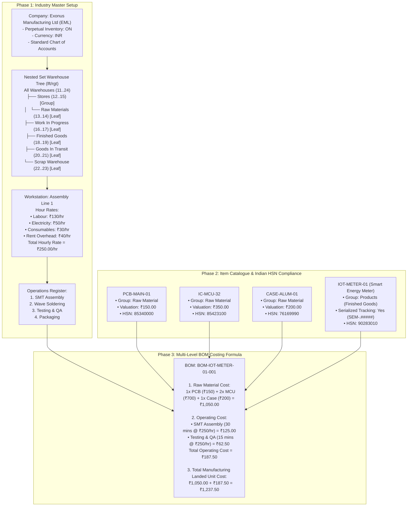

# Manufacturing & Assembly Industry Blueprint: Master Setup & BOM Engine
**Industry Domain:** Electronics, Hardware & Assembly Manufacturing  
**Target Architecture:** Exonus Standalone Engine (TypeScript + SQLite WAL + Modular Desk UI)  
**Parity Source:** ERPNext v16 (`erpnext.manufacturing.doctype.bom`, `erpnext.stock.doctype.item`, `erpnext.stock.doctype.warehouse`) + Frappe v16 + India Compliance v16  
**Documentation Crawl Basis:** 254 parsed priority guides from `https://docs.frappe.io/erpnext/introduction`

---

## 1. Industry Setup Lifecycle Architecture

---

## 2. Mathematical Rules & Formulas Discovered from ERPNext Live Probe

### Rule 1: Operating Cost Calculation per BOM Operation
$$\text{Op Cost} = \left(\frac{\text{time\_in\_mins}}{60}\right) \times \text{workstation.hour\_rate}$$

* **SMT Assembly**: $\frac{30}{60} \times 250.00 = 125.00$
* **Testing & QA**: $\frac{15}{60} \times 250.00 = 62.50$
* **Total Operating Cost**: $125.00 + 62.50 = 187.50$

### Rule 2: Multi-Level Bill of Materials Exploded Cost
$$\text{Total BOM Unit Cost} = \sum (\text{Item Qty} \times \text{Rate}) + \sum (\text{Operation Costs}) - \text{Scrap Material Recovery}$$

* **Raw Materials**: $(1 \times 150) + (2 \times 350) + (1 \times 200) = ₹1,050.00$
* **Operations**: $₹187.50$
* **Total Landed Unit Cost**: $₹1,237.50$

### Rule 3: Indian Compliance Mandatory HSN Validation Rule
When `india_compliance` is active:
* **Item insertion hook**: `validate_hsn_code(doc)` forces mandatory valid 4, 6, or 8-digit HSN/SAC code from `tabGST HSN Code`.
* Items without HSN are strictly blocked at `validate()` before hitting the database.

### Rule 4: Serial / Batch Tracking Pre-condition
* `has_serial_no = 1` or `has_batch_no = 1` on an Item is strictly blocked unless `Stock Settings.enable_serial_and_batch_no_for_item = 1`.

---

## 3. Database Schema Diff & Tables Mutated

The probe captured exact database insertions into MariaDB:
1. **`tabBOM`**:
   * `name`: `BOM-IOT-METER-01-001`
   * `item`: `IOT-METER-01`
   * `quantity`: `1.0`
   * `raw_material_cost`: `1050.00`
   * `operating_cost`: `187.50`
   * `total_cost`: `1237.50`
   * `with_operations`: `1`
   * `docstatus`: `1` (Submitted)
2. **`tabBOM Item`**: Child table with lines for `PCB-MAIN-01` (qty: 1, rate: 150), `IC-MCU-32` (qty: 2, rate: 350), `CASE-ALUM-01` (qty: 1, rate: 200).
3. **`tabBOM Operation`**: Child table linking `SMT Assembly` and `Testing & QA` to `Assembly Line 1`.
4. **`tabItem`**: Updates `last_purchase_rate` and sets BOM references.

---

## 4. Exonus Implementation Guide

To implement this with 100% parity in Exonus:
1. **Database Tables Needed in SQLite**:
   * `workstations` (`id`, `name`, `hour_rate`, `electricity_rate`, `labour_rate`, etc.)
   * `operations` (`id`, `name`)
   * `boms` (`id`, `name`, `item_id`, `quantity`, `raw_material_cost`, `operating_cost`, `total_cost`, `is_active`, `is_default`, `status`)
   * `bom_items` (`id`, `bom_id`, `item_id`, `qty`, `rate`, `amount`)
   * `bom_operations` (`id`, `bom_id`, `operation_id`, `workstation_id`, `time_in_mins`, `hour_rate`, `cost`)
2. **Frontend Desk View**:
   * Add `#manufacturing/bom` Desk page allowing creation of BOMs with live auto-summing of Raw Material and Operation overhead costs.
